<div align="center">

<picture>
  <source media="(prefers-color-scheme: dark)" srcset=".github/assets/banner-dark.svg">
  
</picture>

**Typed HTTP routing and application structure for the PAM runtime.**<br>
Routing, middleware, dependency injection, validation, resources, streaming, OpenAPI and production lifecycle controls, running in persistent PHP workers.

[](https://packagist.org/packages/pushinbr/pam-http)
[](https://github.com/push-in/pam-http/releases/latest)

[](https://github.com/push-in/pam-http/actions/workflows/ci.yml)
[](LICENSE)

[Install](#install) · [Quick example](#quick-example) · [Features](#features) · [Docs](#docs) · [Issues](https://github.com/push-in/pam-http/issues)

</div>

<a id="install"></a>
## <picture></picture> Install

Start a new API with the HTTP template, which already requires `pushinbr/pam-http`:

```sh
pam init my-api --template http
cd my-api
pam dev
```

In an existing PAM project, add the router with `pam composer require pushinbr/pam-http`; PAM runs Composer inside its private Embed SAPI. Run `pam doctor` after dependency changes and before creating a release. The project remains a normal Composer project with a standard manifest, lockfile, PSR-4 autoloading, and `vendor/autoload.php`.

<a id="quick-example"></a>
## <picture></picture> Quick example

```php
<?php

declare(strict_types=1);

use Pam\Api\RouteConstraint;
use Pam\App;
use Pam\Http\Request;
use Pam\Http\Response;

$app = new App;

$app->get('/api/ping', static fn (Request $request, Response $response): Response => $response->json([
    'message' => 'pong',
]));

$app->get('/users/{id}', [UserController::class, 'show'])
    ->where('id', RouteConstraint::Integer)
    ->name('users.show');

$app->listen((int) (getenv('PAM_PORT') ?: 3000));
```

Route parameters are available through `$request->route()`. A path that exists for another method produces 405 behavior; an unknown path produces 404 behavior. Register error handling with `onError()` and keep transport-level timeouts and request limits in the PAM listener options.

<a id="what-you-can-build"></a>
## <picture></picture> What you can build

- Typed JSON APIs and backend services
- Streaming and event-driven HTTP endpoints
- Structured applications with controllers, services, repositories, and resources

| | |
| --- | --- |
| **Role** | HTTP framework |
| **Execution path** | Persistent PHP · PAM transport |
| **This repository owns** | HTTP routing and application structure |
| **Boundary** | PAM owns the runtime; databases and framework integrations stay optional |

<a id="features"></a>
## <picture></picture> Features

| Area | What you get | Guide |
| --- | --- | --- |
| Routing | Route groups, prefixes, `apiResource`, constraints, automatic `HEAD` and `OPTIONS`, bounded router limits | [Route groups](docs/guide.md#route-groups) |
| Container | `bind`, `singleton` and request-`scoped` lifetimes, discarded even when the handler throws | [Container lifetimes](docs/guide.md#container-lifetimes) |
| Configuration | Typed environment definitions that fail at boot, redacted diagnostics | [Typed configuration](docs/guide.md#typed-configuration) |
| Validation | `FormRequest` rules, `JsonResource` envelopes, Problem Details with stable integer codes | [Validation and resources](docs/guide.md#validation-and-resources) |
| Security | Rate limiting with pluggable stores, HS256 bearer tokens with key rotation and revocation | [Rate limiting](docs/guide.md#distributed-rate-limiting), [tokens](docs/guide.md#signed-bearer-tokens) |
| Production | Idempotency, response cache, tenancy, transactions, jobs with leases and dead letters, retries, circuit breakers | [Building blocks](docs/guide.md#production-building-blocks) |
| Observability | Request lifecycle observers and the bounded `MemoryProfiler` | [Observers](docs/guide.md#request-lifecycle-observers) |
| Contracts | OpenAPI output and generated TypeScript, Kotlin and Swift clients | [OpenAPI](docs/guide.md#openapi-and-generated-clients) |
| Database (optional) | Legacy Eloquent bridge with per-Fiber connections, query budgets, tenant guard | [Eloquent ORM](docs/guide.md#eloquent-orm-optional) |
| Testing | In-memory `TestClient` from `pushinbr/pam-http-testing` | [In-memory testing](docs/guide.md#in-memory-testing) |

[Performance contract](docs/PERFORMANCE.md): compiled hot paths and enforced throughput, tail-latency, startup, and memory budgets.

<a id="api-guide"></a>
## <picture></picture> API guide

| Surface | Use it for |
| --- | --- |
| `App` | Register routes, middleware, providers, error boundaries, and the listener. |
| `Router` | Compile and match method/path routes with typed results. |
| `Pipeline` | Execute middleware and the destination handler in order. |
| `CorsMiddleware` | Apply explicit origin, method, and header policy. |
| `RateLimitMiddleware` | Apply bounded per-key request limits. |
| `SecurityHeadersMiddleware` | Set conservative browser security headers. |

The [public API reference](docs/PUBLIC-API.md) is generated from the reviewed `api-surface.json` baseline.

<a id="production-checklist"></a>
## <picture></picture> Production checklist

- Keep request data and mutable state scoped to the current request.
- Test success, validation failure, exception, cancellation, and timeout paths.
- Configure explicit limits and avoid unbounded payloads, queues, or retained collections.
- Run `pam doctor`, `pam test`, and the relevant integration suite before release.
- Validate real dependencies and workload behavior; compatibility is not inferred from package installation alone.

> **Build hygiene:** every local, CI, benchmark, and release build must remove project-scoped regenerable outputs after success or failure. Source, Composer dependencies, and declared evidence are retained. Native consumers inherit PAM's Gradle/Xcode/Rust cleanup contract; this package never deletes another package's artifacts or requires PAM Native.

Troubleshooting notes are in the [guide](docs/guide.md#troubleshooting). See [CONTRIBUTING.md](CONTRIBUTING.md) to contribute (the `composer verify` [quality gate](docs/guide.md#quality-gate)). Report security vulnerabilities through GitHub private vulnerability reporting or the PAM security policy, not a public issue.

<a id="docs"></a>
## <picture></picture> Docs

- [Official documentation](https://push-in.github.io/pam-docs/packages/http/)
- [Guide](docs/guide.md): database, routing, container, configuration, validation, security, jobs, observers, OpenAPI, testing
- [Architecture](docs/ARCHITECTURE.md)
- [Performance contract](docs/PERFORMANCE.md)
- [Public API reference](docs/PUBLIC-API.md)
- [PAM API 2 design and delivery contract](docs/API-2.md)
- [Upgrade guide](UPGRADE.md)
- [Changelog](CHANGELOG.md)
- [Package ecosystem](https://push-in.github.io/pam-docs/packages/overview/)
- [Runtime compatibility](https://push-in.github.io/pam-docs/runtime/compatibility/)

<a id="pam-ecosystem"></a>
## <picture></picture> Part of the PAM ecosystem

<p align="center"><picture>
  <source media="(prefers-color-scheme: dark)" srcset=".github/assets/pam-wordmark-dark.svg">
  
</picture></p>

PAM runs PHP natively on servers, desktops and phones. This repository is one piece of it.

| [**PAM**](https://github.com/push-in/pam) | [**PAM Desktop**](https://github.com/push-in/pam-desktop) | [**PAM Native**](https://github.com/push-in/pam-native) | [**Ecosystem**](https://github.com/push-in/pam#ecosystem) |
| --- | --- | --- | --- |
| the runtime and CLI | native desktop apps in PHP | native Android and iOS apps in PHP | every official package and plugin |

<sub>Docs: [push-in.github.io/pam-docs](https://push-in.github.io/pam-docs/introduction/) · [Issues](https://github.com/push-in/pam-http/issues)</sub>

<p align="center"><sub><a href="LICENSE">Apache License 2.0</a>: use, modify and distribute for any purpose, including commercially · Made in Brazil by Pushin</sub></p>
